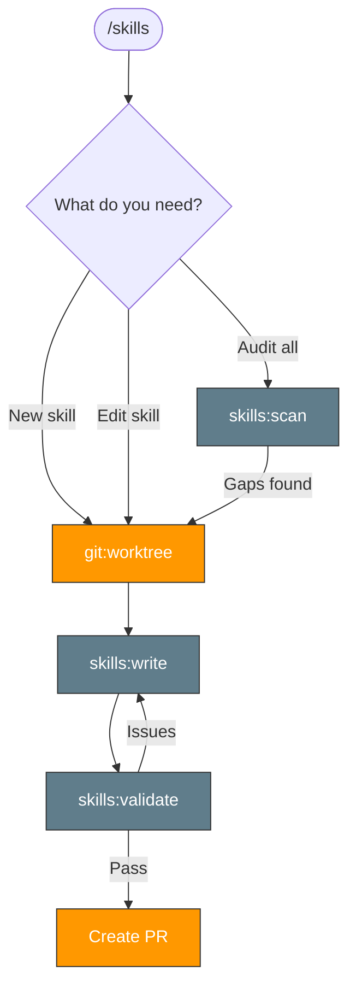

> Follow this diagram as the workflow.

# Skills Management

Skills for managing the skill system itself. **All skill development starts in a worktree** — never edit skills directly on main.

## Worktree-First Gate

Before creating or editing any skill, create a worktree:

```bash
git fetch upstream main
```

```bash
git worktree add ../cortex-worktrees/skills-<topic> -b docs/skills-<topic> upstream/main
```

Then stop, and ask the user to start a new Claude Code session in the worktree from a
separate terminal (a `cd` outside the session's start directory is reset). In that
session, validate and create a PR.

## Available Skills

| Skill | Purpose |
|-------|---------|
| `skills:write` | Create new skills or edit existing ones following the standard template |
| `skills:validate` | Validate skill format, naming, and structure |
| `skills:scan` | Audit repository skills — gaps, quality, connections, diagrams |

## Related Skills

- `skills:write` - Create new skills following the standard
- `skills:validate` - Validate skill format compliance
- `skills:scan` - Audit repository skills
- `orchestrate` - Orchestrate related repositories
