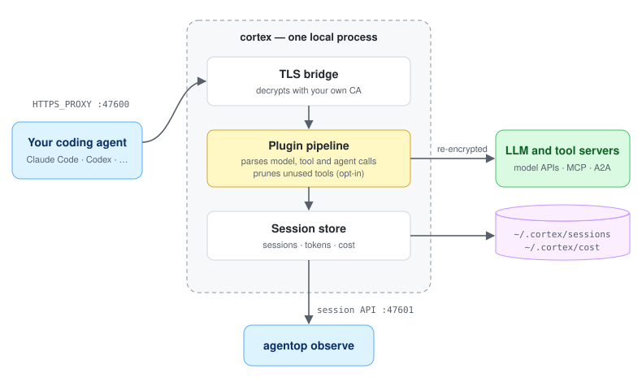

# Cortex

**`top` for your coding agent.** Watch every model call, tool call and dollar your
agent spends, live.

Claude Code · OpenCode · Codex · IBM Bob · Pi · any agent that can use an HTTPS proxy.
One binary on macOS or Linux. No Kubernetes, no account.


## Quick start

<!-- This install command is duplicated in the website's laptop quickstart:
     rossoctl/rossoctl → docs/get-started/laptop.md ("Step 1: install the program").
     Change both, or they drift — the --ref wording already did once. -->

```sh
curl -fsSL https://www.rossoctl.dev/cortex/install.sh | sh
```

Then, in a new terminal:

```sh
agentop configure claude-code enable    # once — or opencode, codex, bob, pi
claude                                  # start (or restart) your agent as you always do
agentop observe                         # in another terminal: watch it live
```

**Next: [Getting started](./docs/getting-started.md)**. It shows what you should see, how to read the screen, and how to undo it.

Setup asks once before changing anything. If something looks wrong, `agentop doctor`
names the fix. A service install [updates itself](./docs/laptop-service.md#automatic-updates);
to update now, run `agentop update`. Can't reach
rossoctl.dev? The same script is [in this repo](https://raw.githubusercontent.com/rossoctl/cortex/main/scripts/install.sh).

Used your agent before Cortex? `agentop import` adds its past sessions and their
cost from the transcripts on disk. Run `agentop import --dry-run` first to count
them. See [Importing agent history](./cmd/agentop/README.md#importing-agent-history-agentop-import).

## What you can do with it

**See where your tokens go.** Every session's tokens, cost and context fill, live.
Open one to read the whole conversation, and the tool list it re-sends every turn.

```sh
agentop observe
agentop cost --window month --by agent
```

**See where a session's time went.** Press `T` on a session in `agentop observe`.
The timeline shows the main agent and each subagent on one time axis: model time,
tool time, retries, and the time the agent waited on you. It also shows each host
that the session called, and its errors. See [Using agentop](./docs/using-agentop.md).

**Switch any agent to another inference server.** Provider down, or your team
has its own gateway? Point the agent at another server without changing the
agent's settings: a LiteLLM gateway, a provider's API, or a model on your own
machine.

```sh
agentop server add work https://llm.example.com --main opus --helper haiku   # once; asks for the key
agentop server use work --agent claude-code                                  # new sessions go there
```

After the `add`, you can also switch in `agentop observe`: press `A` for the
agents, then `S` on one.

Guides: [inference servers](./docs/inference-servers.md) · [pricing](./docs/pricing.md)

## How it works

<!-- Two copies of one drawing, so it follows the reader's GitHub theme. They differ
     only in their <style> block: change the shapes or the text in both. -->
<picture>
  <source media="(prefers-color-scheme: dark)" srcset="./docs/assets/cortex-architecture-dark.svg">
  
</picture>

Your agent uses Cortex as its HTTPS proxy. Cortex decrypts the traffic with a CA made
on your machine, runs it through a pipeline of plugins, and sends it on re-encrypted.
[Running Cortex](./docs/laptop-service.md) covers each piece.

## Supported agents

| Agent | Connect it | |
|---|---|---|
| **Claude Code** | `agentop configure claude-code enable` | [Guide](./docs/agents/claude-code.md) |
| **OpenCode** | `agentop configure opencode enable` | [Guide](./docs/agents/opencode.md) |
| **Codex** | `agentop configure codex enable` | [Guide](./docs/agents/codex.md) |
| **IBM Bob** | `agentop configure bob enable` — the editor and the `bob` shell command both | [Guide](./docs/agents/bob.md) |
| **Pi** | `agentop configure pi enable` | [Guide](./docs/agents/pi.md) |
| **Any other agent** | `agentop exec -- <command>` | [Guide](./docs/agents/any-agent.md) |

`status` and `disable` check and undo each one.

## Your data stays on your machine

- **Loopback only.** Cortex contacts the servers your agent asks for, or the one you
  route it to. Its own calls: LiteLLM's public [price list](./docs/pricing.md), hourly
  (`pricing.bundled: false` turns it off), and the model list of any server you add.
- **Savings metrics go to a central collector.** Every 30s Cortex pushes its counters (tokens
  and dollars saved, request counts and timings, by model) to
  `https://cortex-central.apps.epoc001.ete14.res.ibm.com/cortex`. No prompt, path, host,
  session or key is sent. [Details](./docs/laptop-service.md#the-metrics_push-configuration).
  - To turn it off: in `~/.cortex/config.yaml`, set `metrics_push.enabled: false`, then run
    `agentop service restart`.
  - To turn it back on: set `metrics_push.enabled: true`, then run `agentop service restart`.
- **Your own CA,** created locally in `~/.cortex/ca`. Never added to a keychain by Cortex.
- **Bad certificates aren't intercepted.** When a server's certificate fails, Cortex
  leaves that connection encrypted end to end.
- **Read-only** until you turn on pruning, server routing or an enforcing script.
- **History on disk** in [`~/.cortex/sessions`](./docs/laptop-service.md#session-history-is-kept-in-cortexsessions)
  and `~/.cortex/cost`. `agentop uninstall` removes Cortex;
  `--purge` also deletes `~/.cortex`.

## Beyond the laptop

The same binary runs as a Kubernetes sidecar: a verifiable identity per workload, the
right credentials for each downstream call (**AuthBridge**), guardrails, egress control
and spend caps. Start with [Running Cortex in Kubernetes](./docs/kubernetes.md).

The same binary also runs on a remote machine — a VM, a home server, a pod — with
`agentop` connecting over an encrypted tunnel. See
[Running Cortex on a remote machine](./docs/remote.md).

## Learn more

[Getting started](./docs/getting-started.md) · [Using agentop](./docs/using-agentop.md) · [Troubleshooting](./docs/troubleshooting.md) · [All docs](./docs/README.md)

[agentop reference](./cmd/agentop/README.md) ·
[plugin catalog](./docs/plugin-catalog.md) · [script plugins](./docs/script-plugin.md) ·
[policy in praxis mode](./docs/praxis-policy.md) ·
[install stats](https://rossoctl.github.io/cortex/install-stats/) (from GitHub's download counts, no telemetry)

Something broke? Tell us with the **Laptop feedback** form under
[new issue](https://github.com/rossoctl/cortex/issues/new/choose), or on
[Slack](https://ibm.biz/rossoctl-slack). A half-finished install with the error pasted
in helps more than a polished report never sent. To contribute, see
[CONTRIBUTING.md](./CONTRIBUTING.md); to report a vulnerability, [SECURITY.md](./SECURITY.md).

Licensed under [Apache 2.0](./LICENSE).
