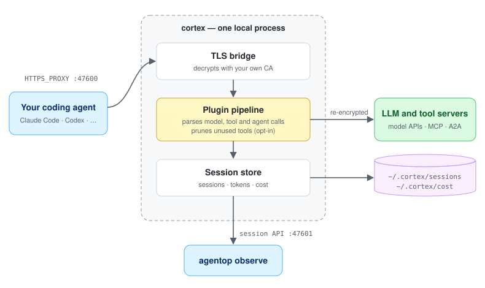

# Cortex

**See what your coding agent actually sends — and pay less for it.**

Works with **Claude Code**, **OpenCode**, **Codex** and **IBM Bob**, and with any agent
that can use an HTTPS proxy.


Cortex sits in your agent's request path on your own machine, decrypts the traffic,
and shows you every model call, tool call and agent-to-agent message as it happens.
**Think `top`, for your coding agent:** `agentop observe` shows which sessions are
eating your tokens, your context window and your money, live. Cortex can also strip
the tool definitions your agent never calls, 4–20% of the prompt on every turn.

One binary, no Kubernetes. macOS or Linux, amd64 or arm64.

## How it works

<!-- Two copies of one drawing, so it follows the reader's GitHub theme. They differ
     only in their <style> block: change the shapes or the text in both. -->
<picture>
  <source media="(prefers-color-scheme: dark)" srcset="./docs/assets/cortex-architecture-dark.svg">
  
</picture>

Your agent uses Cortex as its HTTPS proxy. Cortex decrypts the traffic with a CA
made on your machine, runs it through a pipeline of plugins that parse the model, tool
and agent calls, and sends it on, re-encrypted, to the server it was meant for. Every
request and reply is recorded in its session, with its tokens and cost, and `agentop`
reads them live from the session API. [Running Cortex](./docs/laptop-service.md) covers
each piece; the [plugin catalog](./docs/plugin-catalog.md) lists what else the pipeline
can run.

## Quick start

<!-- This install command is duplicated in the website's laptop quickstart:
     rossoctl/rossoctl → docs/get-started/laptop.md ("Step 1: install the program").
     Change both, or they drift — the --ref wording already did once. -->

```sh
curl -fsSL https://www.rossoctl.dev/cortex/install.sh | sh
```

Setup lists every change it will make, and asks once. If rossoctl.dev is unreachable
from where you are, the same script is served straight from this repository, at
`https://raw.githubusercontent.com/rossoctl/cortex/main/scripts/install.sh`.

To install `cortex` built with the [cpex policy plugin](docs/cpex-plugin.md) instead
(macOS arm64, Linux amd64/arm64), add `| sh -s -- --cpex`. Re-running without the flag
switches back; see [the cpex build](docs/laptop-service.md#the-cpex-build).

Then connect your agent — once, in a new terminal. The table below has each command.

```sh
agentop configure claude-code enable    # or opencode, bob
```

Run your agent the way you always do. No flags, no environment variables.

```sh
claude                                  # or opencode, bob
```

In another terminal, watch its traffic live.

```sh
agentop observe
```

That's all. From now on every session of that agent goes through Cortex, and nothing
changes about how you start it. An agent that was already running picks up the change
when it restarts. If anything looks wrong, `agentop doctor` checks the install and
names the command that fixes it.

## Supported agents

| Agent | Connect it | |
|---|---|---|
| **Claude Code** | `agentop configure claude-code enable` | [Guide](./docs/agents/claude-code.md) |
| **OpenCode** | `agentop configure opencode enable` | [Guide](./docs/agents/opencode.md) |
| **Codex** | `agentop configure codex enable` | [Guide](./docs/agents/codex.md) |
| **IBM Bob** | `agentop configure bob enable` — the editor and the `bob` shell command both | [Guide](./docs/agents/bob.md) |
| **Any other agent** | `agentop exec -- <command>` | [Guide](./docs/agents/any-agent.md) |

Each `configure` command is a one-time setup: it asks before it writes, and afterwards
you start the agent exactly as before. `status` and `disable` check and undo it. An
agent without a `configure` command runs under `agentop exec`, or can be pointed at
the proxy on `localhost:47600` with `~/.cortex/ca/ca.crt` trusted. Traffic in the Anthropic Messages or OpenAI Chat
Completions format is parsed into model calls and tokens whichever agent sends it, and
priced wherever Cortex [has a rate](./docs/pricing.md).

## What Cortex sees and keeps

- **Local only.** The proxy listens on loopback, and it only contacts the servers that
  the programs using it ask for.
- **Your own CA.** Created on your machine, with its key in `~/.cortex/ca`, readable
  only by you. Cortex never adds it to a keychain itself.
- **Real certificates are still checked.** When a server's certificate fails, Cortex
  leaves that connection encrypted end to end.
- **Read-only**, unless you turn on [tool pruning](./docs/laptop-token-savings.md).
- **History on disk.** Sessions, prompts and replies included, are kept in
  [`~/.cortex/sessions`](./docs/laptop-service.md#session-history-is-kept-in-cortexsessions),
  and cost totals in `~/.cortex/cost`.

## Uninstall

```sh
agentop uninstall           # --purge also deletes ~/.cortex
```

It asks once, takes Cortex out of every agent it routed, and removes the service and
binaries. [Remove it](./docs/laptop-service.md#remove-it) has the details.

## Learn more

- [All documentation](./docs/README.md) — the docs index, grouped by what you
  are trying to do
- [Running Cortex](./docs/laptop-service.md) — the service, how sessions are grouped,
  troubleshooting
- [agentop](./cmd/agentop/README.md) — every pane, key and command
- [Run an agent on a local model](./docs/laptop-local-model.md) — Ollama on
  your laptop, for when a provider is out or you want the traffic local
- [Pricing](./docs/pricing.md) — rates, gateway discounts, unpriced traffic
- [Full install guide](https://www.rossoctl.dev/docs/dev/get-started/laptop) —
  prerequisites and a walkthrough. Ending the install command in `sh -s -- --help`
  lists the installer's options.
- [Install stats](https://rossoctl.github.io/cortex/install-stats/) — how many
  people install Cortex, estimated from release downloads with CI subtracted. No
  telemetry: the figures come from GitHub's own download counts, never from your
  machine.

## Beyond the laptop

The same binary runs as a Kubernetes sidecar, with what agentic workloads need in
production: a verifiable identity per workload and the right credentials for each
downstream call (**AuthBridge**), guardrails that block actions straying from the
user's intent, egress control, and spend caps. Start with
[Running Cortex in Kubernetes](./docs/kubernetes.md); the
[plugin catalog](./docs/plugin-catalog.md) and
[architecture reference](./docs/architecture.md) cover the rest.

## Community

Cortex on a laptop is new, so tell us when it breaks: use the **Laptop feedback** form
under [new issue](https://github.com/rossoctl/cortex/issues/new/choose), or
[Slack](https://ibm.biz/rossoctl-slack). A half-finished install with the error pasted
in is more useful than a polished bug report you never sent. To work on Cortex, see
[CONTRIBUTING.md](./CONTRIBUTING.md); to report a vulnerability, [SECURITY.md](./SECURITY.md).

## License

[Apache 2.0](./LICENSE)
