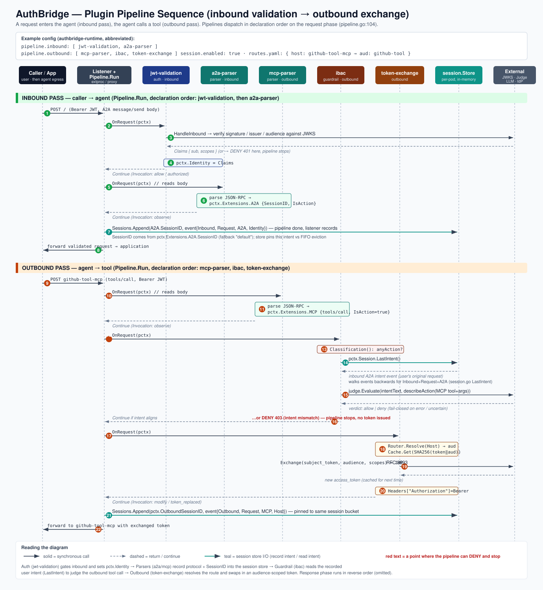

# pipeline — Framework Architecture Reference

Framework-level reference for AuthBridge's plugin pipeline: types, composition, lifecycle, shared state, and the boundary with listeners. Pair this with the plugin-author docs:

- **Tutorial** — [`plugin-tutorial.md`](./plugin-tutorial.md). Writing a plugin from scratch with runnable examples.
- **Plugin author reference** — [`plugin-reference.md`](./plugin-reference.md). Config patterns, invocation emission contract, registration rules.
- **Framework reference** — this file. Pipeline internals and Go surface.

**Audience:**
- Framework maintainers editing `core/pipeline/`.
- Plugin authors who need to understand pipeline composition, lifecycle hooks, the shared state shape, or the observability contract in depth.
- Anyone debugging the plugin flow via `agentop` or the `:9094` session API.

**Scope:**
- The Go surface in `core/pipeline/` and `core/session/`.
- The observability contract carried by `SessionEvent` on the `:9094` API.
- What the pipeline *does* and *does not* own at the boundary with the listener.

For step-by-step "how do I write a plugin?" content, see [`plugin-tutorial.md`](./plugin-tutorial.md) first.

---

## 1. Mental model

AuthBridge intercepts HTTP traffic in two directions and runs a **separate plugin chain** for each. Each chain has two **phases** — request (headers/body going to the upstream) and response (headers/body coming back).

```
          Inbound (caller → this agent)
          ┌────────────────────────────────────────────────────┐
          │  Request phase  →  jwt-validation                  │
          │                 →  a2a-parser                      │
          │                 →  session-recorder   (implicit)   │
          │  Response phase ←  a2a-parser OnResponse           │
          │                 ←  jwt-validation OnResponse       │
          └────────────────────────────────────────────────────┘

          Outbound (this agent → target service)
          ┌────────────────────────────────────────────────────┐
          │  Request phase  →  route-resolver                  │
          │                 →  token-exchange                  │
          │                 →  mcp-parser / inference-parser   │
          │  Response phase ←  mcp-parser / inference-parser   │
          │                 ←  token-exchange OnResponse       │
          └────────────────────────────────────────────────────┘
```

**Key properties:**
- Plugins execute **sequentially** within a phase.
- Response phase runs plugins in **reverse order** (last plugin sees the response first — LIFO, matches middleware conventions).
- Inbound and outbound are **separate `Pipeline` instances**. A plugin that cares about both directions is registered on both.
- All state shared between plugins within one request/response cycle lives on `*pipeline.Context` (`pctx`).
- Cross-request state (per-session telemetry) lives in the `session.Store`, accessed read-only via `pctx.Session`.

---

## 2. The `Plugin` interface

```go
type Plugin interface {
    Name() string
    Capabilities() PluginCapabilities
    OnRequest(ctx context.Context, pctx *Context) Action
    OnResponse(ctx context.Context, pctx *Context) Action
}
```

### `Name() string`
A stable identifier. Used for logs, metrics, `GetState`/`SetState` keys (by convention), and pipeline introspection (`GET /v1/pipeline`).

### `Capabilities() PluginCapabilities`

```go
type PluginCapabilities struct {
    Reads      []string // extension slot names this plugin reads
    Writes     []string // extension slot names this plugin writes
    ReadsBody  bool     // plugin reads pctx.Body / pctx.ResponseBody
    WritesRequestBody  bool    // plugin mutates the request body via pctx.SetBody
    WritesResponseBody bool    // plugin mutates the response body via pctx.SetResponseBody
}
```

Declared once per plugin instance. `pipeline.New` validates that every `Read` is satisfied by an earlier plugin's `Write` — a plugin that depends on `mcp` being populated cannot be registered before `mcp-parser`. A mis-ordered registration fails fast at startup with:

```
plugin "guardrail" reads slot "mcp" but no earlier plugin writes it
```

`ReadsBody: true` on *any* plugin in a chain causes `Pipeline.NeedsBody()` to return true, which the **listener** uses to negotiate Envoy's `ProcessingMode` (BUFFERED vs HEADERS-only). Without this, the gRPC ext_proc server never asks for the body and parsers see `pctx.Body == nil`.

`WritesRequestBody: true` declares that the plugin may rewrite the request body via `pctx.SetBody`; `WritesResponseBody: true` declares the response side via `pctx.SetResponseBody`. The listener propagates the mutation to the wire, and only `WritesResponseBody` forfeits incremental SSE relay. See §6, "Body mutation" for the full body-mutation contract (capability rules, ordering constraints, Content-Encoding policy).

### `OnRequest(ctx, pctx) Action`
Called when a request is entering the pipeline. Plugins typically read request headers / body, mutate one or more extension slots, and return `Continue` or `Reject`.

### `OnResponse(ctx, pctx) Action`
Called after the upstream returns. `pctx.StatusCode`, `pctx.ResponseHeaders`, and `pctx.ResponseBody` are populated. Plugins typically enrich the telemetry extensions with response-side data (completion text, token usage, error code) or apply guardrails on the response content.

Plugins that only care about the request set `OnResponse` to a no-op (`return Action{Type: Continue}`); same for response-only plugins on `OnRequest`.

---

## 3. `pipeline.Context` — the shared state

The entire surface a plugin sees:

```go
type Context struct {
    Direction Direction        // Inbound | Outbound
    Method    string           // HTTP method
    Scheme    string           // "http" | "https" | ... ; empty when the listener can't determine it
    Host      string           // :authority / Host
    Path      string           // :path
    Headers   http.Header
    Body      []byte           // nil unless a plugin declared ReadsBody: true
    StartedAt time.Time        // listener wall-clock at request entry

    Agent    *AgentIdentity   // this workload's SPIFFE / Keycloak identity
    Identity Identity          // caller identity after an auth plugin runs (interface)
    Session  *SessionView      // read-only view of the session bucket

    // Response-phase fields (populated by listener before RunResponse)
    StatusCode      int
    ResponseHeaders http.Header
    ResponseBody    []byte

    Extensions Extensions
}
```

**Ownership rules:**
- Plugins **read** any field they declared in `Capabilities.Reads`.
- Plugins **write** fields they declared in `Capabilities.Writes`. By convention each extension slot has exactly one writer (the parser plugin).
- Plugins read `pctx.Body` / `pctx.ResponseBody` only if they declared `ReadsBody: true`. One exception: `lineage-telemetry` reads them without declaring it, so that it may sit after a plugin that rewrites the body; the parsers it requires declare `ReadsBody`, so the bodies are buffered (see its `Capabilities()`).
- Plugins mutate body content via `pctx.SetBody(newBytes)` if they declared `WritesRequestBody: true`, or `pctx.SetResponseBody(newBytes)` if they declared `WritesResponseBody: true`. Direct assignment (`pctx.Body = ...`) compiles but bypasses listener propagation and misses the Invocation + body-mutation event emission — see §6, "Body mutation."
- `Identity` is populated by whichever auth plugin ran (jwt-validation ships a `claimsIdentity` adapter around `validation.Claims`; a SAML / mTLS / custom plugin publishes its own adapter). The framework reads it through the `Identity` interface (`Subject()` / `ClientID()` / `Scopes()`) so no plugin-specific type leaks into `pipeline/`.
- `Agent`, `Session` are populated by the listener before `Run`. Plugins treat them as read-only.
- `ResponseBody` appears between `Run` and `RunResponse` — plugins must not read it in `OnRequest`.

**Framework-owned attribution.** `pipeline.Run` / `RunResponse` stamp the currently-dispatching plugin's name and phase onto unexported fields of `pctx` around each plugin call. These drive the `pctx.Record` family of helpers so Invocation entries are auto-attributed without plugin-side ceremony. Plugins can't set them directly (unexported); exported `SetCurrentPlugin` / `ClearCurrentPlugin` exist for test harnesses that invoke plugins outside a `Pipeline.Run` dispatch loop.

**Recording Invocations.** Plugins emit per-call diagnostic records through Context helpers:

```go
pctx.Allow("authorized")                          // gate approved
pctx.Skip("path_bypass")                          // plugin ran but didn't act
pctx.Observe("matched_tools/call")                // parser extracted data
pctx.Modify("token_replaced")                     // plugin mutated the message
pctx.Record(pipeline.Invocation{                  // full form with diagnostic fields
    Action: pipeline.ActionDeny,
    Reason: "jwt_failed",
    Details: map[string]string{
        "expected_issuer":   issuer,
        "expected_audience": audience,
    },
})
return pctx.DenyAndRecord(reason, code, message)  // emit + reject in one call
```

Framework fills `Plugin`, `Phase`, `Path`; authors supply only what's specific to this call. See [`plugin-reference.md`](./plugin-reference.md#emitting-session-events) for the full 5-value action vocabulary and field reference.

**Lifetime:** one `*Context` per HTTP transaction. Not reused across requests. Single-threaded — the pipeline guarantees sequential invocation of plugins within a phase, so plugins don't need internal locking for pctx reads/writes.

### Example

A typical configuration validates inbound traffic with the auth plugins, lets the
protocol parsers record what is happening, has a guardrail consult the recorded
session, and finally exchanges a token on the way out:

```yaml
# authbridge-runtime (abbreviated)
session:
  enabled: true
pipeline:
  inbound:  [ jwt-validation, a2a-parser ]
  outbound: [ mcp-parser, ibac, token-exchange ]
# routes.yaml: { host: github-tool-mcp → audience: github-tool }
```

The diagram below traces a request through that configuration: an inbound message
is validated and recorded, then the workload's outbound tool call is judged
against the recorded intent and finally re-tokenized.



The pipelines dispatch in **declaration order** on the request phase. On the
inbound pass `jwt-validation` runs first (and can reject with `401`), then
`a2a-parser` records the user's request into the session store. On the outbound
pass `mcp-parser` records the tool call, `ibac` reads the recorded intent to judge
it (and can reject with `403`), and `token-exchange` swaps in an audience-scoped
token. The response phase runs the same plugins in reverse order.

---

## 4. `Extensions` — typed plugin-to-plugin communication

```go
type Extensions struct {
    MCP         *MCPExtension
    A2A         *A2AExtension
    Security    *SecurityExtension
    Delegation  *DelegationExtension
    Inference   *InferenceExtension
    Invocations *Invocations       // per-plugin action records for every plugin that ran
    Custom      map[string]any     // plugin-private state + escape-hatch public events
}
```

Three categories of cross-plugin / cross-phase state:

### Invocations — per-plugin action record (always recorded)

Every plugin that runs on a pipeline pass appends at least one `Invocation` to this slot via the `pctx.Record` family of helpers. The listener snapshots it onto `SessionEvent.Invocations` so `agentop` and `/v1/sessions` see a per-plugin timeline.

```go
type Invocation struct {
    Plugin  string           // plugin.Name(); framework-filled
    Action  InvocationAction // 5-value: allow | deny | skip | modify | observe
    Phase   InvocationPhase  // "request" | "response"; framework-filled
    Reason  string           // machine-stable code, e.g. "path_bypass"
    Path    string           // request path; framework-filled

    // Plugin-specific diagnostic context. Opaque to the framework;
    // rendered as key=value rows by agentop. Built-in plugins populate
    // expected_issuer, token_subject, route_host, target_audience,
    // cache_hit (snake_case). Third-party plugins define their own
    // key space. Stringify booleans as "true"/"false" and []string
    // as space-joined to match OAuth scope conventions.
    Details map[string]string
}

type Invocations struct {
    Inbound  []Invocation
    Outbound []Invocation
}
```

Every plugin is expected to call one of `pctx.Allow` / `Skip` / `Observe` / `Modify` / `Record` / `DenyAndRecord` per active phase — see [`plugin-reference.md`](./plugin-reference.md#emitting-session-events) for the full field reference and 5-value vocabulary.

### Named protocol slots (telemetry-worthy, optional per plugin)
MCP, A2A, Inference, plus Security and Delegation. These are:
- Part of the **published schema** carried on `SessionEvent` to `:9094` / `agentop`.
- Consumable by multiple downstream plugins.
- Added to the core struct only when the data has a public contract.

A parser populates its slot AND records an Invocation with `ActionObserve`. The slot carries the structured payload (method, token counts, etc.); the Invocation carries the attribution.

Adding a named slot is a `core` change: edit `Extensions`, add a wire field on `sessionEventWire`, update `snapshotXXX` helpers in the listener, and add filtering rules in `agentop`.

**Capability interfaces on the slot types.** Named-slot extensions may implement optional capability interfaces declared in [`core/capabilities/`](../core/capabilities/) so consumer plugins can interact with them without importing any specific parser package. The current capability is [`ContentSource`](../core/capabilities/content.go) — implemented by `A2AExtension`, `MCPExtension`, and `InferenceExtension` — which lets guardrail plugins iterate inspectable text fragments via `pctx.ContentSources()`. Parser authors opt in by adding one method (`Fragments() []capabilities.Fragment`); consumers see a uniform view across every protocol that implements the contract. See [`plugin-reference.md` "Exposing content to guardrails"](./plugin-reference.md#exposing-content-to-guardrails) for the pattern.

**Classification on the slot types.** Each protocol extension also carries an `IsAction bool` field — the parser's verdict on whether the request is a user-meaningful action (judge it) or protocol mechanics (skip it). Parsers explicitly set `IsAction = true` for the small set of known action methods (`tools/call`, `prompts/get`, `resources/read` for MCP; `message/send`, `message/stream` for A2A; every populated case for inference); everything else inherits the zero-value false. Guardrails read the verdict aggregated across every populated extension via [`pctx.Classification()`](../core/pipeline/context.go), which returns `(anyAction, anyBypass)`. A defense-in-depth guardrail (IBAC pattern) skips on `anyBypass`, passes through on `!anyAction`, and judges only when `anyAction && !anyBypass`. This keeps protocol-specific knowledge in the parsers — adding a new guardrail or a new protocol doesn't multiply work at the guardrail layer.

### `Custom map[string]any` — plugin-private state + escape-hatch public events
Two access patterns share the same map, disambiguated by key suffix.

**Plugin-private cross-phase state.** Use `GetState[T]` / `SetState[T]`:

```go
// Plugin's private state type:
type rlState struct {
    TokensAtStart int
    Decision      string
}

// In OnRequest:
pipeline.SetState(pctx, "rate-limiter", &rlState{TokensAtStart: 100})

// In OnResponse:
s := pipeline.GetState[rlState](pctx, "rate-limiter")
if s != nil { /* use s */ }
```

Convention: **key = plugin's Name()** so collisions across plugins don't happen. Storage is lazy (`Custom` is nil-initialized until first write).

`GetState[T]` type-asserts and returns `nil` on mismatch instead of panicking — a plugin whose type evolves across versions degrades gracefully.

**Plugin-public escape-hatch events.** Write a key ending in `pipeline.PluginEventSuffix` (`"/event"`) with a JSON-marshalable value; the listener promotes it to `SessionEvent.Plugins[pluginName]` on the wire:

```go
pctx.Extensions.Custom["rate-limiter" + pipeline.PluginEventSuffix] = rateLimiterEvent{
    Allowed:    true,
    TokensLeft: 42,
}
```

The suffix is the opt-in marker — private state stays out of the session stream. Graduate to a named slot when two or more plugins share the shape. See [`plugin-reference.md`](./plugin-reference.md#emitting-session-events) for the graduation criteria.

### Built-in extension shapes

All at `core/pipeline/extensions.go`:

```go
type MCPExtension struct {
    Method   string          // JSON-RPC method, e.g. "tools/call"; or "$transport/stream" / "$transport/terminate" for body-less MCP transport patterns
    RPCID    any             // JSON-RPC id (could be int or string)
    Params   map[string]any  // request params
    Result   map[string]any  // response result (mutually exclusive with Err)
    Err      *MCPError
    IsAction bool            // parser's classification verdict; true for tools/call, prompts/get, resources/read; false for housekeeping + transport
}

type A2AExtension struct {
    Method       string
    RPCID        any
    SessionID    string  // contextId from the client, or server-assigned on first turn
    MessageID    string
    TaskID       string
    Role         string  // "user" | "agent"
    Parts        []A2APart
    FinalStatus  string  // response: "completed" | "failed" | "canceled"
    Artifact     string  // response: assembled artifact text
    ErrorMessage string  // response: failure reason
    IsAction     bool    // parser's classification verdict; true for message/send + message/stream
}

type InferenceExtension struct {
    // Request side:
    Model       string
    Messages    []InferenceMessage
    Temperature *float64
    MaxTokens   *int
    TopP        *float64
    Stream      bool
    Tools       []InferenceTool  // full definition incl. parameters schema
    ToolChoice  any
    ToolResults []InferenceToolResult // Anthropic tool_result blocks: toolUseId, text, isError.
                                      // For the session store only — no plugin reads them.
    // Response side:
    Completion       string
    FinishReason     string
    PromptTokens     int
    CompletionTokens int
    TotalTokens      int
    ToolCalls        []InferenceToolCall
    // Classification: every populated InferenceExtension is an outbound LLM call.
    IsAction         bool  // unconditionally true when populated
}

type SecurityExtension struct {
    Labels      []string // classifier / guardrail output
    Blocked     bool
    BlockReason string
}

type DelegationExtension struct {
    Origin string   // original caller subject
    Actor  string   // current actor subject
    // chain is append-only via AppendHop; reads via Chain()
}
```

Mutability: **always assigned, never mutated in place** after the parser sets the slot. This guarantees that `snapshotXXX` in the listener (shallow-copy for event recording) stays correct even when OnResponse enriches the struct — the response snapshot is taken from the now-enriched pointer, but any earlier request-phase snapshot was taken of a frozen copy.

---

## 5. `Action` — control flow

```go
type Action struct {
    Type      ActionType // Continue | Reject
    Violation *Violation // populated iff Type == Reject
}

type Violation struct {
    // Structured machine-readable error:
    Code        string         // machine-readable, e.g. "auth.missing-token"
    Reason      string         // short human message
    Description string         // longer explanation; optional
    Details     map[string]any // plugin-arbitrary structured context; optional

    // HTTP rendering hints — all optional; defaults from Code:
    Status   int         // when 0, StatusFromCode(Code) is used
    Body     []byte      // when nil, synthesized JSON
    BodyType string      // Content-Type for Body; defaults to application/json
    Headers  http.Header // merged into the response (e.g. WWW-Authenticate, Retry-After)

    // Framework-populated from Plugin.Name(); plugins leave it empty:
    PluginName string
}
```

Returning `Reject` from `OnRequest` halts the request pipeline; from `OnResponse` halts the response pipeline. The listener calls `Violation.Render()` to produce `(status, headers, body)` and emits that as the HTTP response. The default body when `Body` is nil:

```json
{
  "error":       "auth.missing-token",
  "message":     "Bearer token required",
  "description": "No Authorization header present",
  "plugin":      "jwt-validation",
  "details":     { "realm": "rossoctl" }
}
```

Helper constructors cover the common cases so the reject site stays one line:

```go
pipeline.Deny("auth.invalid-token", "token expired")
pipeline.DenyStatus(451, "policy.forbidden", "unavailable for legal reasons")
pipeline.DenyWithDetails("policy.rate-limited", "quota hit", map[string]any{
    "remaining": 0, "window": "1h",
})
pipeline.Challenge("rossoctl", "Authorization required")   // 401 + WWW-Authenticate
pipeline.RateLimited(30*time.Second, "", "slow down")     // 429 + Retry-After
```

The `Code` → HTTP-status mapping for well-known codes lives at `codeToStatus` in `action.go`; unknown codes default to 500. Plugins that need a non-default status set `Violation.Status` explicitly or use `DenyStatus`.

Fail-open vs fail-closed is a per-plugin `on_error` policy (`enforce` / `observe` / `off`) — see [`plugin-reference.md`](./plugin-reference.md#on_error-policy) for the contract.

---

## 6. `Pipeline` — composition and execution

```go
func New(plugins []Plugin, opts ...Option) (*Pipeline, error)
func (p *Pipeline) Run(ctx context.Context, pctx *Context) Action                  // request phase
func (p *Pipeline) RunResponse(ctx context.Context, pctx *Context) Action          // response phase (reverse)
func (p *Pipeline) RunFinish(ctx context.Context, pctx *Context, outcome Outcome)  // finish phase (reverse)
func (p *Pipeline) Start(ctx context.Context) error                                // invoke Init on Initializer plugins
func (p *Pipeline) Stop(ctx context.Context)                                       // invoke Shutdown on Shutdowner plugins
func (p *Pipeline) Plugins() []Plugin                                              // defensive copy
func (p *Pipeline) NeedsBody() bool                                                // OR over ReadsBody + both write flags
```

`New` validates capability wiring at startup: every `Read` must be satisfied by some earlier plugin's `Write`. `plugins.Build` additionally validates the cross-plugin relationship declarations — `Requires`, `RequiresAny`, `RequiresLater` — before returning the pipeline to the listener. See [`plugin-reference.md` "Declaring plugin relationships"](./plugin-reference.md#declaring-plugin-relationships).

### Plugin lifecycle (`Start` / `Stop`)

Plugins that need one-time setup (load a model, warm a cache, register metrics, spawn a background goroutine) implement the optional `Initializer` interface:

```go
type Initializer interface {
    Init(ctx context.Context) error
}
```

Plugins that need graceful cleanup (flush audit events, close a connection, cancel a goroutine) implement `Shutdowner`:

```go
type Shutdowner interface {
    Shutdown(ctx context.Context) error
}
```

Both are **optional** via Go's type-assertion idiom — a plugin that doesn't need them simply doesn't implement them, and the pipeline skips it. Existing plugins (jwt-validation, a2a-parser, mcp-parser, inference-parser, token-exchange) don't implement these; they keep working unchanged.

The host (e.g. `cmd/cortex/main.go`) drives the lifecycle:

```go
// After pipeline.New, before listeners accept traffic:
initCtx, cancel := context.WithTimeout(context.Background(), 60*time.Second)
defer cancel()
if err := inboundPipeline.Start(initCtx); err != nil {
    log.Fatalf("inbound pipeline Start: %v", err) // fail-fast on bad plugin init
}
if err := outboundPipeline.Start(initCtx); err != nil {
    log.Fatalf("outbound pipeline Start: %v", err)
}

// ... serve traffic ...

// After listeners have drained (a pod) or closed (a local install) on SIGTERM:
outboundPipeline.Stop(shutdownCtx) // reverse order within each pipeline
inboundPipeline.Stop(shutdownCtx)
```

Semantics:
- `Start` — Init runs **in declaration order**, fails fast on the first error. The returned error names the offending plugin. No Shutdown is invoked on plugins whose Init already ran successfully — the intent is hard-fail on startup, not unwind.
- `Stop` — Shutdown runs **in reverse declaration order (LIFO)** so a plugin that depends on an earlier plugin's resources can still use them while cleaning up. Best-effort: errors from one Shutdown are logged but do not stop the sequence. Bounded by the caller's ctx deadline — in `cmd/cortex`, 15s in a pod and 1s on a local install, whose stop has to finish inside its supervisor's 3s.

A minimal Init/Shutdown plugin example — a rate-limiter that refreshes its quota store in the background:

```go
type RateLimiter struct {
    store  *quotaStore
    cancel context.CancelFunc
}

func (p *RateLimiter) Name() string { return "rate-limiter" }
func (p *RateLimiter) Capabilities() pipeline.PluginCapabilities { return pipeline.PluginCapabilities{} }

func (p *RateLimiter) Init(ctx context.Context) error {
    p.store = newQuotaStore()
    bg, cancel := context.WithCancel(context.Background())
    p.cancel = cancel
    go p.store.refreshLoop(bg, 10*time.Second) // lives until Shutdown
    return nil
}

func (p *RateLimiter) Shutdown(ctx context.Context) error {
    p.cancel()             // stop the refresh loop
    return p.store.flush(ctx) // best-effort write-back of pending counters
}

func (p *RateLimiter) OnRequest(ctx context.Context, pctx *pipeline.Context) pipeline.Action {
    if !p.store.allow(pctx) {
        return pipeline.RateLimited(30*time.Second, "", "quota exceeded")
    }
    return pipeline.Action{Type: pipeline.Continue}
}

func (p *RateLimiter) OnResponse(context.Context, *pipeline.Context) pipeline.Action {
    return pipeline.Action{Type: pipeline.Continue}
}
```

### Per-request finish hook (`Finisher`)

Plugins that reserve per-request state in `OnRequest` need a guaranteed release point — whether the request was allowed, denied by a later plugin, or errored at the upstream. Without such a hook, a rate-limiter that reserves a slot in `OnRequest` and releases it in `OnResponse` silently leaks the slot whenever a later plugin denies (because `OnResponse` is only walked when the pipeline returned `Continue`). The `Finisher` optional interface closes this:

```go
type Finisher interface {
    OnFinish(ctx context.Context, pctx *Context)
}
```

`OnFinish` fires **once per request**, after `OnResponse` if it ran, on every plugin whose `OnRequest` was actually invoked — including the plugin that denied (if any). Dispatch is LIFO, symmetric with `Shutdowner` and `RunResponse`, so a plugin's cleanup can still depend on earlier plugins' resources. The listener calls `Pipeline.RunFinish` in a `defer` wrapping the response-produce block:

```go
pctx := newContext(...)
defer func() {
    pipeline.RunFinish(ctx, pctx, pipeline.Outcome{
        FinalAction:   finalAction, // OutcomeAllow | OutcomeDeny | OutcomeError
        StatusCode:    statusCode,
        DenyingPlugin: denyingPlugin, // "" unless FinalAction == OutcomeDeny
    })
}()
// ... Run, write response, RunResponse ...
```

Key contract points, chosen to make the plugin-author surface small and hard to misuse:

- **Fresh ctx with a framework-set deadline.** `OnFinish` does not receive the request `ctx` — that one may be cancelled (client disconnect) by the time the response is on the wire. The framework derives a fresh ctx from `context.Background()` with `DefaultFinishTimeout` (2s) applied, overridable via `WithFinishTimeout`. Plugins doing network I/O (flushing audits, releasing a distributed lease) see a live ctx by default.
- **`pctx.Outcome()` returns non-nil only during OnFinish.** The `*Outcome` carries `FinalAction` (three values: `OutcomeAllow` / `OutcomeDeny` / `OutcomeError`), `StatusCode`, `DenyingPlugin`, and `Duration`. In `OnRequest` / `OnResponse` the getter returns nil, so the "only meaningful in OnFinish" contract is enforced at read time rather than via documented zero-value semantics.
- **Full pctx is available**, including response body — the framework buffers through the finish window so audit / metrics plugins can read the final payload.
- **Best-effort dispatch.** A panic is recovered and logged; later plugins in the LIFO chain still run. One misbehaving plugin does not leak state in every other plugin.
- **OnFinish is silent.** The framework does NOT auto-emit `Invocation` records for this phase. `pctx.Record` called from within `OnFinish` is dropped with a WARN log (SessionEvent is frozen once the response is published). Plugins that want observability on cleanup publish through their own sink (Prometheus, external audit service) or the `pctx.Extensions.Custom` escape-hatch map.
- **Body mutation is forbidden.** `pctx.SetBody` / `SetResponseBody` called from `OnFinish` are dropped with a WARN log — the response is already on the wire.
- **`on_error: off` plugins are never dispatched in any phase**, so their `OnFinish` never runs either (consistent with the "only plugins whose OnRequest actually ran" participation rule).

Canonical rate-limiter:

```go
type rlState struct{ tenant string }

func (p *RateLimiter) OnRequest(_ context.Context, pctx *pipeline.Context) pipeline.Action {
    tenant := pctx.Identity.ClientID()
    p.slots.Reserve(tenant)
    pipeline.SetState(pctx, "rate-limiter", &rlState{tenant: tenant})
    return pipeline.Action{Type: pipeline.Continue}
}

func (p *RateLimiter) OnFinish(ctx context.Context, pctx *pipeline.Context) {
    s, ok := pipeline.GetState[*rlState](pctx, "rate-limiter")
    if !ok {
        return
    }
    p.slots.Release(s.tenant)
    p.metrics.RecordOutcome(pctx.Outcome().FinalAction) // allow / deny / error buckets
}
```

Contrast with the pre-Finisher workaround: reserve in `OnRequest`, release in `OnResponse` — leaks on every denied request. Or: reserve in `OnRequest`, spawn a goroutine with a TTL-based release — leaks goroutines on process shutdown and runs on a timer, not on the actual response.

### Extension slots known to the validator

Built-in: `mcp`, `a2a`, `security`, `delegation`, `inference`, `custom`.

**For plugins that write new slot names:** use the `WithSlots` option:

```go
pipeline, err := pipeline.New(plugins,
    pipeline.WithSlots("provenance", "risk-score"))
```

This tells the validator those slot names are legal, so a downstream plugin can `Capabilities.Reads = []string{"provenance"}` without being rejected as "unknown slot".

### Execution order
- Request phase: `plugins[0].OnRequest → plugins[1].OnRequest → …`
- Response phase: `plugins[N-1].OnResponse → plugins[N-2].OnResponse → …`
- A `Reject` from any plugin halts its phase immediately.
- `ctx.Err() != nil` between plugins also halts with `Reject{Status: 499}`.

### Concurrency model
Always sequential. No priority / mode / fire-and-forget semantics yet. This is the 80% case for auth-and-parse pipelines; richer modes would require an executor layer above the current loop.

### Body mutation

A plugin declares the direction it rewrites: `WritesRequestBody: true` for the request body (`pctx.SetBody`), `WritesResponseBody: true` for the response body (`pctx.SetResponseBody`). The framework owns the propagation to the wire; plugins only call the helper.

**Capability model.** Body access is declared per direction on `PluginCapabilities`:

| Field | Meaning | Listener effect |
|---|---|---|
| `ReadsBody` | plugin reads `pctx.Body` / `pctx.ResponseBody` | buffers the body; plugin sees the bytes |
| `WritesRequestBody` | plugin may call `pctx.SetBody` | implies `ReadsBody`; propagates request mutations |
| `WritesResponseBody` | plugin may call `pctx.SetResponseBody` | implies `ReadsBody`; propagates response mutations **and forces the buffered response path** |

**Why the directions are separate.** `Pipeline.WritesResponseBody()` is the SSE
streaming predicate: both proxy listeners consult it to decide whether a
`text/event-stream` response may be relayed incrementally. It was previously one
undirected flag, which meant a plugin rewriting only the *request* body disabled
*response* streaming for bytes it never touched. The cost was latency and feel
rather than correctness — the buffered path restores the body verbatim — but a
long completion arriving in one lump after a silent wait is the first thing
anyone notices. Request bodies are never streamed (they arrive complete with a
`Content-Length` and are read end to end before dispatch), so a request-only
mutator now keeps incremental relay.

`pipeline.New` enforces two rules at build time:

1. **Mutators chain in both directions.** Any number of `WritesRequestBody` plugins may share a pipeline: they run in chain order, each seeing `pctx.Body` as the one before it left it, and the listener sends the last one's bytes. Any number of `WritesResponseBody` plugins may too: the response pass runs in reverse, so each sees `pctx.ResponseBody` as the one after it in the chain left it, and the listener sends what the last to run left. One plugin may write both directions.
2. **A mutator of either direction cannot precede a `ReadsBody`-only plugin.** Readers see what the agent saw: the request as the client sent it and — because the response pass runs in reverse and the parsers' per-frame pass runs after it — the response as the client receives it.

**Mutation helpers.** `SetBody` / `SetResponseBody` replace the byte slice and flip an internal `bodyMutated` / `responseBodyMutated` flag that listeners read via `pctx.BodyMutated()` / `pctx.ResponseBodyMutated()`. Each returns whether *its own* write took effect — `false` for a shadow write under `on_error: observe` or a call dropped in `OnFinish` — because the flag is direction-wide: once one writer's bytes took effect it is true for every later writer too, shadow or not. They also auto-emit:

- A `modify`-action Invocation with `Reason: "body_rewritten"`, framework-attributed to the mutating plugin.
- A plugin-public event under `pctx.Extensions.Custom["body-mutation" + PluginEventSuffix]` with the phase (`request` / `response`), byte length and sha256 before and after, and the writers: `plugins` lists every plugin whose write took effect in that direction, in order — or, while none has, the observed writer whose would-be rewrite this describes (its invocation carries `shadow: true`) — and `plugin` is the last. With several request mutators the event describes the chain — before is the body the client sent, after the body sent upstream — and a write under `on_error: observe` never replaces the record of one that took effect. Never the raw body content — the session store is unauthenticated.

Once `pctx.BodyMutated()` is true, `pctx.Body` is the request body the listener sends: each applied `SetBody` replaces it and a shadow write leaves it alone. Settlement calibrates a byte saving on `len(pctx.Body)` then, not on the published event, which holds a shadow's would-be length while nothing has taken effect and is replaced by a response write.

The flags (not byte-compare) are the source of truth. A rewrite that produces byte-identical output still records the Invocation because "redactor ran, nothing matched" is valid telemetry.

**Wire propagation (per listener).**

| Listener | Request body | Response body |
|---|---|---|
| `extproc` | `withBodyMutation` helper wraps the `RequestBody ProcessingResponse` with an ext_proc `BodyMutation`. Envoy replaces the buffered body; in BUFFERED + SEND mode the processor must set `Content-Length` itself (`processing_mode.proto`, `BodySendMode`), so the helper does. | Same pattern in the response-body handler. |
| `forwardproxy` | On mutation, rebuild `r.Body` from `pctx.Body`, set `r.ContentLength` + `Content-Length` header. | Replace `resp.Body` + `resp.ContentLength` + `Content-Length`. |
| `reverseproxy` | Same as forwardproxy on the inbound request before handing to `httputil.ReverseProxy`. | Same as forwardproxy on the response from the upstream. |

Every mutation path also **clears `Content-Encoding`**: the framework can't know whether the plugin decompressed a gzipped body before rewriting, so shipping plain bytes without the old encoding header beats shipping a malformed archive. Auto-decompress/recompress is a possible future feature, explicitly out of scope today.

**Body-size limits.** Bodies over the listener's buffer cap are rejected at buffer time — before the mutator sees anything. On the forward proxy that is 32 MiB for a request (`maxRequestBodySize`) and 10 MB for a response (`maxBodySize`); on the reverse proxy it is 1 MB either way. Plugins don't need to guard against oversized input.

**Streaming.** Only buffered mutation is supported. Responses that stream (SSE, chunked bodies beyond the buffer cap) are not mutable today; a streaming-transform API is a separate project.

---

## 7. `Session` + `SessionEvent` — the observability side-channel

The pipeline itself is **in-band** (plugins alter request handling). Alongside it runs an **out-of-band** observability layer: the listener snapshots `pctx` into a `SessionEvent` after each phase and appends it to a per-session bucket in the `session.Store`. This store is what powers the `:9094` HTTP API and `agentop`.

```go
type SessionEvent struct {
    SessionID      string                     // bucket the event landed in
    At             time.Time
    Direction      Direction                  // inbound | outbound
    Phase          SessionPhase               // request | response | denied
    A2A         *A2AExtension              // snapshot of pctx.Extensions.A2A
    MCP         *MCPExtension
    Inference   *InferenceExtension
    Invocations *Invocations               // per-plugin action records, filtered by phase
    Plugins     map[string]json.RawMessage // plugin-public events (escape-hatch /event suffix)
    Identity    *EventIdentity             // Subject, ClientID, AgentID, Scopes
    StatusCode  int                        // response phase only
    Error       *EventError                // 4xx/5xx, a guardrail block, or a failed upstream exchange
    Host        string                     // :authority
    Duration    time.Duration              // response: wall-clock since request entry
}
```

**Three phase values:**
- `request` — snapshot taken after the request pipeline completes, carrying request-phase invocations.
- `response` — snapshot taken after the response pipeline completes, carrying response-phase invocations. Status, duration, and response parser output live here.
- `denied` — terminal denial by a pipeline plugin (jwt-validation reject, token-exchange failure, guardrail block). Carries the request-phase invocations plus the Violation's structured `Error`.

**Plugins do not touch `SessionEvent` directly.** The listener records events. Plugins append Invocations via `pctx.Record` / `Allow` / `Skip` / `Observe` / `Modify` / `DenyAndRecord`, populate extension slots (A2A / MCP / Inference) via assignment, and read `pctx.Session` (a `*SessionView`) when they want to correlate the current request with prior ones in the same conversation — e.g. a rate-limiter that counts a session's inference events.

Wire format (`SessionEvent.MarshalJSON`) translates enums to strings and `Duration` to `DurationMs`. Round-trip stable — `json.Marshal(e) → json.Unmarshal → json.Marshal` is byte-identical. Tested at `pipeline/session_test.go:TestSessionEvent_JSONRoundTrip`.

### Operator configuration (`session:`)

The store's limits live under the top-level `session:` block. **None of it is
hot-reloadable** — every consumer reads the block exactly once at startup, so
an edit is refused by the reloader and takes effect on restart:

| Field | Default | Meaning |
|---|---|---|
| `enabled` | `true` | The store (and implicitly the session API). `false` turns both off. |
| `ttl` | *(never)* | How long a session survives after its last event. |
| `max_events` | *(unset)* | FIFO per-session event cap. Unset by default: a trimmed store is lossy on exactly the sessions worth reading, and `?before=` paging (see [`session-api.md`](session-api.md)) keeps depth readable without it. With a session archive, a cap drops nothing a reader can no longer reach. |
| `max_sessions` | `100` | How many sessions are kept, oldest-used evicted first. The only default bound on memory — `max_events` and `ttl` unset means one long-lived chatty session grows without limit. |
| `id_headers` | *(known agent headers)* | Headers consulted, in order, for a client-supplied session id — defaults to the known coding-agent session headers when unset. |
| `client_affinity` | *(auto)* | Pin a session to the client process that started it, so two agents sharing an id keep separate sessions. |
| `process_attribution` | *(auto)* | Attribute traffic to the peer process holding the connection (`auto` / `on` / `off`). Needs `id_headers` non-empty, like `client_affinity`. |
| `archive.*` | *(laptop only)* | The on-disk session history — see [`laptop-service.md`](laptop-service.md#session-history-is-kept-in-cortexsessions). Turning the store off with the archive explicitly on is refused at load. |

---

## 8. Boundary: pipeline vs listener

The pipeline **does not own**:

| Concern | Owner | Why |
|---|---|---|
| HTTP wire protocol (ext_proc gRPC, reverse/forward proxy) | `core/listener/` | Each mode speaks a different wire; pipeline stays protocol-free |
| Body buffering negotiation (`ProcessingMode: BUFFERED`) | Listener reads `Pipeline.NeedsBody()` | Only listener can respond to the ext_proc handshake |
| JWT issuance, client registration, Keycloak admin calls | Outside the pipeline (agent sidecars / operator) | Async concerns happening before/after any request flow |
| Session store writes (`Store.Append`) | Listener, called after each phase | Plugins see only the read-only `SessionView` |
| SSE streaming of events to agentop | `core/sessionapi` | Observability API, not a plugin concern |
| **mTLS handshake + peer-cert verification** | **`core/listener/...` (proxy-sidecar) using `core/tlsconfig` + `core/spiffe`** | **Transport-level concern; happens before any plugin sees a decrypted HTTP message** |

### 8a. mTLS layer

When `mtls:` is configured at the top level, the proxy-sidecar
listeners (reverse + forward proxy) run TLS termination /
origination using a SPIRE X.509 SVID. The plugin pipeline is
unaware of TLS — by the time `OnRequest` fires, bytes have already
been decrypted.

Two small additive surfaces let plugins opt into connection-level
identity:

- `pctx.TLS *tls.ConnectionState` — the inbound handshake state when
  the connection went through TLS. Convenience accessor
  `pctx.PeerCertificate()` returns the verified leaf cert. Plugins
  that want per-caller policy use `core/tlsconfig.PeerSPIFFEID` to extract
  the URI SAN. Most plugins ignore it.
- `SessionEvent.TLS *EventTLS` — version, cipher, peer SPIFFE ID per
  event. Listeners populate it; agentop renders it in the events
  detail pane. Pure observability.

The mTLS code lives in `core/tlsconfig` + `core/spiffe` (framework-
shared) and `core/listener/internal/tlssniff` (listener-internal
byte-peek dispatcher). Only `cmd/cortex` wires it up (this
also covers the `authbridge-lite` image — the same binary built with the
`lite` profile); `cmd/cortex-envoy` stays on
plaintext-localhost because Envoy handles wire encryption via SDS
independently.

mTLS config changes require a pod restart (matches the listener-
config reload boundary in §9 below).

#### Operator configuration

```yaml
# authbridge-runtime-config ConfigMap (top-level)
mtls:
  mode: strict          # permissive | strict (omit block entirely for off)
```

`mode` is the only field the block carries; cert paths default to
`/opt/svid.pem`, `/opt/svid_key.pem`, `/opt/svid_bundle.pem` (the SPIFFE
Provider's file mirror). Legacy `cert_file` / `key_file` / `bundle_file` keys
are dropped at load.

| Mode | Inbound (reverse proxy `:8080`) | Outbound (forward proxy) |
|---|---|---|
| (no `mtls` block) | Plaintext only. | Plaintext only. |
| `permissive` (default when block present) | Byte-peek listener: TLS handshakes verified against the SPIRE trust bundle; plaintext callers served on the same port. ⚠️ Plaintext requests carry their full headers and bodies in the clear — including any `Authorization: Bearer ...` token already injected by `token-exchange`. Use only during rollout with cluster-network trust. | Plaintext — no TLS-wrap attempt. Matches envoy-sidecar's permissive and Istio's PeerAuthentication semantics (permissive is inbound-only). |
| `strict` | TLS only — non-TLS callers get the connection closed. | TLS or fail: handshake failure is a hard error, no fallback. |

In both modes, a successful TLS handshake that fails certificate verification
is always a hard error.

**Trust model:** any peer with a valid cert from the SPIRE trust bundle can
talk to this sidecar. Per-caller policy / SPIFFE allowlists are out of scope;
the trust bundle IS the policy. Plugins that want per-caller decisions read
`pctx.PeerCert` and check the URI SAN.

**Reload boundary:** a reload that adds the `mtls` block, removes it, or
changes `mtls.mode` is refused rather than half-applied — the active pipeline
keeps serving, `reloads_failed` increments, and `/reload/status` names
`mtls.*` among the fields that need a restart. The inbound TLS listener and,
under `strict`, the forward proxy's mTLS dialer are built once at boot, so no
reload can reach them. The outbound chain's redirect check
(`forwardproxy.Support`) refuses a `WritesDestination` plugin whenever an
`mtls:` block is configured — under `strict` the dialer would nest TLS inside
TLS; under `permissive` there is no dialer, so the refusal is broader than
strictly needed and fails closed.

**Mixed-mode note:** a *permissive* caller cannot reach a *strict* peer
regardless of mode (its outbound is plaintext; the peer's strict inbound
rejects it). Mixed-mode deployments need both ends compatible — both strict,
both permissive, or one strict + the other permissive on inbound only.

#### envoy-sidecar mTLS

In envoy-sidecar mode the listeners live in Envoy, not the sidecar binary, so
the top-level `mtls:` block is a no-op there. Equivalent semantics are
configured at the Envoy data-plane level by extending the `envoy-config`
ConfigMap with TLS blocks:

| Mode | Inbound (`:15124`) | Outbound (`:15123`) |
|---|---|---|
| `disabled` | plaintext | plaintext |
| `permissive` | `tls_inspector` listener filter + two filter chains: `transport_protocol: tls` chain terminates mTLS, `transport_protocol: raw_buffer` chain accepts plaintext | **plaintext** — no TLS-wrap attempt |
| `strict` | `tls_inspector` + single TLS filter chain; plaintext drops at filter chain match | `UpstreamTlsContext` on the `original_destination` cluster: TLS-or-fail, blanket |

X.509 SVIDs are read by Envoy directly from `/opt/svid.pem`,
`/opt/svid_key.pem`, `/opt/svid_bundle.pem` — the same paths proxy-sidecar's
mTLS uses; the spiffe Provider's file-mirror in the `cortex-envoy` binary
keeps them fresh on rotation. Inbound parity with proxy-sidecar is
byte-identical observable semantics — the same outcome as proxy-sidecar's
`tlssniff.Listener`, expressed as Envoy filter chains, matching Istio's
PERMISSIVE/STRICT. Outbound is Istio-shaped: Envoy has no native primitive
for "try TLS, fall back to plaintext on handshake failure" within an
`ORIGINAL_DST` cluster, so permissive keeps outbound plaintext and strict
does blanket TLS-or-fail. The operator's AgentRuntime CR `Spec.MTLSMode`
flows through to a per-agent rendered envoy-config with the matching TLS
blocks.

> **This envoy-sidecar design has no end-to-end verification in-tree.** The
> `demos/mtls/` demo that used to exercise it was retired as superseded.
> Nothing in-tree exercises the Envoy filter chains — re-verify by hand after
> changing them.

The pipeline **does own**:
- The `Plugin` interface contract.
- `pipeline.Context` structure and invariants.
- Validation of capability wiring at construction.
- Sequential dispatch and reject-short-circuit semantics.
- Typed extension slots and `GetState`/`SetState` helpers.
- The session-event *shape* (the listener uses it but doesn't define it).

---

## 9. Config hot-reload

Editing `authbridge-config-<agent>` no longer requires a pod restart. `core/reloader` watches the mounted config file and atomically swaps the inbound / outbound pipelines when content changes; listeners drain onto the new pipeline, old in-flight requests finish on the previous one.

**The moving parts**

| Component | Responsibility |
|---|---|
| `pipeline.Holder` | `atomic.Pointer[*Pipeline]` slot that listeners read every request. Delegating methods (`Run`, `RunResponse`, `NeedsBody`, `Ready`, `NotReadyPlugin`, `Plugins`) so call sites don't change. |
| `core/reloader.Reloader` | Owns the fsnotify watcher, debouncer, content-hash dedup, validation, and drain scheduling. |
| `main.go` | Provides a `PipelineBuilder` closure that mirrors the startup `Load → ApplyPreset → Validate → plugins.Build` sequence, so startup and reload run identical code. |

**Operator workflow**

```sh
# 1. Edit the mounted ConfigMap
kubectl edit configmap authbridge-config-<agent> -n <ns>
#    (or: kubectl apply -f …)

# 2. Wait ~60s for kubelet to sync the new content into the mount.
#    For instant reload during testing, restart the pod instead.

# 3. Confirm the swap via the stats port
kubectl port-forward -n <ns> deploy/<agent> 9093:9093 &
curl http://localhost:9093/reload/status        # last_success, counters, sha256
curl http://localhost:9093/config               # now-active config
```

**Reload lifecycle (what happens when the file changes)**

1. fsnotify event on the parent directory — we watch `/etc/authbridge/`, not `/etc/authbridge/config.yaml` directly, because ConfigMap mounts use symlink swap (`..data → ..<timestamp>`). A direct file watch misses the retarget.
2. Debounce 250 ms so a symlink-swap's REMOVE+CREATE+CHMOD burst fires one reload, not three.
3. SHA-256 dedup — identical bytes are ignored (mtime-only touches don't trigger rebuilds).
4. `PipelineBuilder` runs: `config.Load` → mode override → `ApplyPreset` → `Validate` → `plugins.Build`. Any failure records the error in `Status.LastError` and leaves the active pipeline untouched.
5. Compare the new config to the active one on unreloadable fields (`Mode`, `Listener.*`, `Session.*`, `CostLedger.*`, `MTLS.*`); refuse if they differ (see below).
6. `Start` the new pipelines with a 60 s budget. On Start failure, `Stop` any partially-started pipelines so their goroutines don't leak.
7. `inboundH.Store(newIn)` + `outboundH.Store(newOut)` — new requests now route to the new pipelines.
8. Background goroutine: `time.Sleep(drainWindow)` (default 30 s) → `oldPipeline.Stop(ctx)` with a 15 s budget. In-flight requests that already Loaded the old pipeline finish against it.
9. `Status.LastSuccess`, `ReloadsOK`, `ActiveConfigSHA256` update atomically.

**What's reloadable, what isn't**

| Change | Reloadable? | Why |
|---|---|---|
| Plugin list (add / remove / reorder plugins) | ✅ | Pipeline is rebuilt from scratch |
| A plugin's `config:` subtree (issuer, bypass paths, routes, JWKS URL, etc.) | ✅ | Plugin's `Configure` runs again with new bytes |
| `mode` (`envoy-sidecar` / `proxy-sidecar`) | ❌ | Different wire protocol + listener set; refuse reload |
| `listener.*` (ports, `skip_hosts`, interception addresses) | ❌ | Bound sockets and skip-host patterns are read at listener construction; refuse reload |
| `session.*` (TTL, MaxEvents, MaxSessions, ID headers) | ❌ | Every consumer reads the block once at startup — `session.New(...)` in each `cmd` main, `forwardproxy.Server.SessionIDHeaders` assigned before `ListenAndServe`. There is no live object to reach; refuse reload |
| `cost_ledger.*` (`enabled`, `dir`, `retention_days`) | ❌ | The ledger is a `*ledger.Writer` opened once at startup and handed to the session store as a `Recorder`. Refuse reload |
| `mtls.*` (the block's presence and `mode`, the only field it carries) | ❌ | The inbound TLS listener and, under `strict`, the forward proxy's mTLS dialer are built once at startup, and the outbound chain is built for `forwardproxy.Support` of that state; refuse reload. Legacy `cert_file` / `key_file` / `bundle_file` keys are dropped at load, so an edit to them is neither applied nor refused |
| `tls_bridge.*` (mode, ca_dir, passthrough_hosts, ports, …) | ❌ | The bridge engine is built once at boot in each `cmd` main and nothing re-reads the block; refuse reload. An accepted-but-ineffective edit here is the dangerous shape: an operator adding a host to `passthrough_hosts` reads the successful reload as confirmation it stopped being intercepted |
| `spiffe.*` (socket, mirror settings, …) | ❌ | The in-process Provider is constructed once at boot and handed to plugins through `Deps` at build time; refuse reload |

**Why `session.*` and `cost_ledger.*` are refused rather than "reloaded but ineffective".**
Both used to be accepted: the reload succeeded, `ReloadsOK` incremented,
`ActiveConfigSHA256` moved and `/config` served the new values — while the objects built at
startup carried on unchanged. That is worse than a refusal, because all three of those
signals read as confirmation. An operator who edits `cost_ledger.enabled: false` to stop
recording cost history had every reason to believe it had stopped, and the writer kept
appending to the old directory under the old retention. `validateReloadable` now compares
both blocks the way it compares `mode` and `listener.*`, so the reload fails,
`Status.LastError` names the block, `ReloadsFailed` bumps, and the answer is a pod restart.

For the unreloadable cases, `Status.LastError` names the field(s) that changed and `ReloadsFailed` bumps — the operator can see from `/reload/status` that a pod restart is required.

**Validation guarantee: bad YAML never takes the pod down.** Any failure during Load / Validate / Build / Start results in the status being updated and the active pipeline continuing to serve traffic on the previous config. Only a successful end-to-end reload swaps the holders.

**Non-reloadable choices elsewhere.** The in-memory session store, the cost ledger, the stat server, the session API server, and the reloader itself are all process-scoped — they live from startup to shutdown. A change to `session.enabled`, `cost_ledger.enabled`, `stats.address`, `listener.session_api_addr`, or the reloader's own knobs (drain window, debounce) requires a pod restart. `session.*`, `cost_ledger.*`, `listener.*` and `mtls.*` are refused outright, per the table above; `stats.address` and the reloader's own knobs are read once at construction, so an edit there is simply not seen.

#### Skipping infrastructure hosts (`listener.skip_hosts`)

`skip_hosts` lists infrastructure destinations — OTel collectors, metrics
endpoints, log shippers — whose traffic should bypass the plugin pipeline
**and** session recording entirely. A matched request is forwarded as a
transparent proxy: no plugin runs, no event is appended.

```yaml
listener:
  skip_hosts:
    - "otel-collector.*.svc.cluster.local"
    - "*.metrics.local"
```

Patterns use the same `.`-delimited glob semantics as `authproxy-routes`
hosts; ports are stripped before matching. Any change requires a pod restart,
like every other `listener.*` field. Do **not** add hosts here that need IBAC
or token-exchange policy applied — bypass means bypass. It exists for traffic
whose recording floods the session store and crowds out the user intent a
guardrail needs (see the intent-pin note in [`laptop-service.md`](laptop-service.md)).

#### Forwarding WebSocket upgrades

Every WebSocket upgrade the forward proxy does not decline is forwarded (#1488), plain
and TLS-bridged alike. `Upgrade` is hop-by-hop, which is why it is stripped from
ordinary requests — but an upgrade exchange makes the proxy an endpoint of the hop
instead of a reader between two: everything after the 101 is opaque to it, so the
header must cross or the origin never sees an upgrade request at all. The forwarded
pair is normalized to `Connection: Upgrade` / `Upgrade: websocket` (the one protocol
forwarded, mirroring `httputil.ReverseProxy`), which also pins the exchange to
HTTP/1.1 — net/http does that by itself (`Request.requiresHTTP1`), so the bridge's
h2-negotiating upstream client needs no HTTP/1.1-only twin for upgrades. An upgrade
GET on a bridged tunnel is held to the CONNECT-host check like any bridged request
(421 otherwise); on a bridged tunnel the splice is doubled, agent↔bridge and
bridge↔origin.

**What counts as an upgrade is both headers, on both sides, and neither check is a
formality** — because the proxy *writes* the normalized pair, a predicate that is too
loose does not merely miss a forward, it manufactures one:

- **The request** needs `Connection: upgrade` as well as `Upgrade: websocket` (RFC
  9110 §7.8: a recipient ignores `Upgrade` unless `Connection` lists it — the same
  test `Request.requiresHTTP1` and ReverseProxy's `upgradeType` make). A bare
  `Upgrade: websocket` with no `Connection` token takes the ordinary path and is
  stripped. Honouring it would have the proxy forge a handshake the client never
  sent and splice the origin's 101 onto a connection whose client is waiting for an
  ordinary HTTP response — an opaque byte pipe no plugin inspects, from a request
  that was not an upgrade.
- **The response** must switch to the protocol that was asked for. A 101 only says
  "switching"; its own `Upgrade` header says to what. An origin answering `101
  Upgrade: h2c` to a WebSocket handshake is refused with 502 *before* the hijack —
  while a status is still writable — rather than spliced, matching
  `handleUpgradeResponse`, which rejects a `resUpType`/`reqUpType` mismatch.

The 101 is hijacked and spliced onto the client's connection
(`relayUpgradedWebSocket`, modelled on ReverseProxy's `handleUpgradeResponse`), and
the session records the request row plus a paired 101 response row carrying both
directions' byte counts, recorded after both splice directions end — `durationMs`
covers the whole WebSocket session, `ttfbMs` the handshake. The frames after the 101
are relayed byte for byte and never inspected or buffered, so no response plugin runs
on a 101 and a body parser sees only the upgrade GET. A non-101 answer (an origin
serving the bare GET, refusing the upgrade) takes the ordinary response path.

Out of scope: WebSocket over HTTP/2 downstream (RFC 8441 Extended CONNECT) — a client
that wants h2 websockets through the proxy gets its fallback path, same as before
forwarding existed.

#### Declining Responses API WebSockets (`listener.decline_responses_websockets`)

The forward proxy answers a WebSocket upgrade on OpenAI's Responses API — a `GET` with
`Upgrade: websocket` on a path ending `/responses`, to `chatgpt.com` or `api.openai.com`
— with **426 Upgrade Required** itself, and forwards nothing. On by default in every
deployment.

```yaml
listener:
  decline_responses_websockets: false   # forward the upgrade for real
```

The decline is a steer, not a capability gap: a forwarded Responses WebSocket works
(the section above), but its frames are opaque to every plugin, so a Codex session
moved onto one stops being parseable — no token counts, no cost. A 426 sends Codex
straight to HTTPS, where its traffic stays observable; before forwarding existed the
calculation was harsher still, because the stripped handshake drew a 405 that Codex
retried for ~6s. `false` forwards the upgrade for real instead. The scope is exact —
OpenAI's own hosts only — because what a 426 means is only known for Codex against
OpenAI, and another client (or another host serving the same API: a LiteLLM gateway,
OpenCode Zen, a local server) is forwarded whatever this says. Restart to
apply, like every `listener.*` field. The key goes in the runtime config: on a laptop,
`~/.cortex/config.yaml`, then `agentop service restart`; in a cluster, the
`authbridge-runtime-config` ConfigMap, then a pod restart. See
[`agents/codex.md`](agents/codex.md#what-cortex-shows-for-it) for the measured difference.

#### Refusing private destinations (`listener.egress_guard`)

Arms the forward proxy's SSRF dial guard (#1484): every destination the proxy
dials — CONNECT tunnels, plain and bridged requests, transparent redirects,
and `skip_hosts` traffic too, because a bypass must not become an SSRF bypass
— is resolved **once**, refused with **403 `destination_private`** when the
address is loopback, link-local (including the cloud metadata address
`169.254.169.254`), RFC 1918 / unique-local space, RFC 6598 CGNAT shared
space (`100.64.0.0/10`, where Alibaba's metadata service lives), or one of
this host's own interface addresses — the addresses themselves, not their
on-link subnets, so a LAN neighbour or a public neighbour on a large on-link
prefix is not caught by that clause — and then **dialed at the checked
address**. That last part is the DNS-rebinding defense: the address the guard
checked and the address the proxy connects to are the same value by
construction, so a second lookup can never re-answer between check and
connect. A well-known-prefix NAT64 address (`64:ff9b::/96`) is judged by the
IPv4 address it embeds, so `[64:ff9b::7f00:1]` is refused as the `127.0.0.1`
it carries.

```yaml
listener:
  egress_guard:
    enabled: true
    permit_cidrs: ["127.0.0.1/32"]   # prefixes within the refused space
```

**Off by default, deliberately.** A sidecar's ordinary upstreams — Keycloak,
in-cluster services, a laptop's local model — live in exactly the refused
space, so defaulting this on would break every existing deployment. Enable it
where the sandbox's egress is meant to be public-only, and list the private
prefixes still needed in `permit_cidrs`.

`permit_cidrs` covers prefixes within the refused space only. Link-local,
unspecified, multicast and the AWS IPv6 metadata address (`fd00:ec2::254`)
are **never** permitted, whatever the list says: `0.0.0.0` reaches loopback
on every mainstream stack, `169.254.169.254` is the metadata service this
guard exists among other things to protect — a permit of `0.0.0.0/0` does not
open it — and `fd00:ec2::254` is that service's IPv6 form, which would
otherwise sit in the permit-able ULA space.

A refused CONNECT leaves its two tunnel rows with
`tunnelReason: "dest-private"` and `error.kind: "destination_private"`; a
refused request leaves an ordinary response row with the same error kind.
A permitted tunnel's open row carries `dialAddr`, the checked address that
was dialed — the audit trail that pairs the name the client asked for with
the address the proxy reached. Restart to apply, like every `listener.*`
field. See `core/listener/egressguard` for the refusal set's exact rules.

---

## 10. Writing a plugin

For a step-by-step tutorial that walks through building a new plugin from scratch — minimal plugin, recording invocations, rejection, config, body access, out-of-tree packaging, testing — see [`plugin-tutorial.md`](./plugin-tutorial.md).

For the plugin-author reference (config conventions, invocation field list, registration rules, 5-value action vocabulary), see [`plugin-reference.md`](./plugin-reference.md).

This document stays focused on the pipeline framework internals — how plugins compose, how the shared state is shaped, how control flows. The two plugins-side docs build on top of it.

---

## 11. Open questions

- **Execution modes.** The pipeline is sequential-only. Concurrent or fire-and-forget modes would require an executor layer; no concrete use case yet.

---

## 12. Versioning

The plugin interface is **not** semver-stable yet (AuthBridge is pre-1.0). Changes since the initial release:
- Added `BodyAccess` to `PluginCapabilities`.
- Added `WithSlots` to `New` for bridge-plugin slot registration.
- Added `GetState[T]` / `SetState[T]` generic helpers.
- Extended `A2AExtension` with response-side fields (TaskID, FinalStatus, Artifact, ErrorMessage).
- Extended `InferenceExtension` with structured tools + tool calls + TopP / ToolChoice.
- Added `SessionEvent.MarshalJSON`/`UnmarshalJSON` round-trip contract.
- **Breaking**: replaced `Action.Status`/`Action.Reason` with `Action.Violation` (see §5). Migration: use `Deny()`, `DenyStatus()`, `Challenge()`, `RateLimited()` helpers.
- Added optional `Initializer` / `Shutdowner` / `Readier` interfaces + `Pipeline.Start` / `Pipeline.Stop` (see §6). Existing plugins are unaffected because the interfaces are opt-in via type-assertion.
- Added `SessionDenied` phase and `recordInboundReject` in the listener so denials surface as session events with full diagnostic context.
- **Unified invocation contract**: `AuthExtension` + `InboundAuth` + `OutboundAuth` collapsed into `Invocations` + `Invocation`. Every plugin (gate, parser, future) emits an Invocation record per pipeline pass using the 5-value `InvocationAction` vocabulary (allow / deny / skip / modify / observe). `SessionEvent.Auth` is now `SessionEvent.Invocations`.
- **`pctx.Record` helpers**: `Allow` / `Skip` / `Observe` / `Modify` / `Record` / `DenyAndRecord` on `Context`. Framework-managed attribution (`currentPlugin`, `currentPhase`, `Path`) fills Invocation fields automatically.
- **Open plugin registry**: plugins self-register from `init()` via `plugins.RegisterPlugin`. Third-party plugins in external modules drop in via a side-effect import. Closed `registry` map literal removed.
- **Config hot-reload**: new `pipeline.Holder` (atomic wrapper) + `core/reloader` package (fsnotify-driven). Listeners receive `*Holder` instead of `*Pipeline`; the reloader atomically swaps the holder's contents when the config file changes. `mode` and `listener.*` edits are refused (pod restart required); any other change is picked up within the kubelet sync window (~60s). See §9.
- **Body mutation**: `PluginCapabilities.BodyAccess` split into `ReadsBody` / `WritesRequestBody`. New `pctx.SetBody` / `pctx.SetResponseBody` helpers flip a mutation flag; all three listeners (extproc / forwardproxy / reverseproxy) propagate the rewrite to the upstream with correct `Content-Length` and cleared `Content-Encoding`. `BodyAccess` was kept as a deprecated alias at the time; it has since been removed. See §6, "Body mutation."
- **Detyped framework**: `pipeline/` no longer imports plugin-specific packages. **Breaking**: `Context.Claims *validation.Claims` → `Context.Identity Identity` (interface with `Subject()`/`ClientID()`/`Scopes()`); plugins publish adapters. `Context.Route` removed (was dead code). `Invocation`'s nine jwt-validation + token-exchange specific fields (`ExpectedIssuer`, `TokenSubject`, `RouteHost`, `CacheHit`, etc.) collapsed into `Details map[string]string`; built-in plugins migrated to `Details["expected_issuer"]` etc. `SessionEvent.TargetAudience` removed (was only populated from dead `pctx.Route`). Third-party plugins get a clean diagnostic slot they can populate without framework edits.
- **Single-owner packages relocated**: `core/validation` → `core/plugins/jwtvalidation/validation`. `core/exchange` / `core/cache` / `core/spiffe` → `core/plugins/tokenexchange/{exchange,cache,spiffe}`. Each plugin now lives in its own directory (`plugins/jwtvalidation/plugin.go`, `plugins/tokenexchange/plugin.go`) and self-registers via its own init(). `core/bypass`, `core/routing`, `core/auth` stay shared.
- **Plugin relationship declarations**: `PluginCapabilities` extended with chain-scoped fields — `Requires` (all-must-be-earlier), `RequiresAny` (at-least-one-earlier), and later `RequiresLater` (the mirror of `Requires` for response-phase output: the named plugin must sit at a *higher* index, because the response pass walks the chain in reverse). Validated at `plugins.Build` time (startup + hot-reload); all errors per chain are collected into one report. See [`plugin-reference.md` "Declaring plugin relationships"](./plugin-reference.md#declaring-plugin-relationships).
- **Per-request finish hook (`Finisher`)**: new optional interface `Finisher { OnFinish(ctx, pctx) }` gives stateful plugins a guaranteed release point that fires after every request end — regardless of whether the pipeline allowed, denied, or errored. Dispatch is LIFO across Finisher-implementing plugins whose OnRequest was invoked (including the denier). `pctx.Outcome()` returns a non-nil `*Outcome{FinalAction, StatusCode, DenyingPlugin, Duration}` during OnFinish and nil in all other phases. OnFinish runs under a fresh ctx derived from `context.Background()` with a framework-set deadline (default 2s, `WithFinishTimeout` overrides) so client disconnect during the request doesn't cancel cleanup I/O. Best-effort: panics are recovered; OnFinish is silent (no auto-emitted Invocations); `pctx.Record` / `SetBody` / `SetResponseBody` called during OnFinish are dropped with WARN logs since the SessionEvent is published and the response is on the wire. Closes the rate-limiter / audit / lease class of "cleanup leaks on denial" bugs. See §6 "Per-request finish hook".

Breaking changes will be announced in `CHANGELOG.md` (TBD) before a 1.0 tag.

---

## 13. Cross-references

**Plugin-author docs** (pair with this framework reference):

- [`plugin-tutorial.md`](./plugin-tutorial.md) — step-by-step tutorial for writing a plugin.
- [`plugin-reference.md`](./plugin-reference.md) — plugin-author reference: config patterns, invocation emission contract, registration rules.

**Package sources:**

- `pipeline.go` — `Pipeline` type, `New`, `Run`, `RunResponse`, `Start`, `Stop`, `Plugins`, `NeedsBody`, `WritesRequestBody`, `WritesResponseBody`.
- `holder.go` — `Holder`, the atomic slot listeners hold in place of a raw `*Pipeline`.
- `plugin.go` — `Plugin` interface, `PluginCapabilities` (with `ReadsBody` / `WritesRequestBody` / `WritesResponseBody` + `Normalize()`; chain-scoped relationship fields `Requires` / `RequiresAny` / `RequiresLater`), `Configurable`, `Initializer`, `Shutdowner`, `Readier`, `Finisher`.
- `outcome.go` — `Outcome` struct + `OutcomeAction` (allow / deny / error) for `Finisher` consumers; `Context.Outcome()` getter.
- `action.go` — `Action`, `ActionType`, `Violation`, helper constructors (`Deny`, `DenyStatus`, `DenyWithDetails`, `Challenge`, `RateLimited`), `StatusFromCode`.
- `context.go` — `Context`, `Direction`, `AgentIdentity`, the `pctx.Record` / `Allow` / `Skip` / `Observe` / `Modify` / `DenyAndRecord` helpers, and `pctx.SetBody` / `SetResponseBody` / `BodyMutated` / `ResponseBodyMutated` for body mutation.
- `extensions.go` — `Extensions` struct, `Invocation`, `Invocations`, `InvocationAction`, named protocol extensions, `GetState` / `SetState`.
- `session.go` — `SessionEvent`, `SessionView`, `SessionPhase`, marshalers.
- `core/reloader/` — `Reloader`, `Status`, `PipelineBuilder`, `WithDrainWindow` / `WithDebounce` / `WithStartTimeout`, `Handler()` (serves `/reload/status`).

**Downstream integrators:**

- `core/session/` — `Store`, `SessionSummary`, ring buffer, TTL / max-events caps.
- `core/sessionapi/` — HTTP API (`/v1/sessions`, `/v1/events`, `/v1/pipeline`) surfacing all of the above.
- `core/plugins/` — built-in plugin implementations and registry.
- `core/listener/extproc/` — reference usage for all three phases.
- `cmd/agentop/` — TUI consumer of the session API, useful as a reference integrator.
