# Using agentop

`agentop` shows the traffic that Cortex sees: sessions, events, tokens and cost.
This guide is a first tour for a laptop user.
For every flag and key, read the [agentop reference](../cmd/agentop/README.md).
The screens on this page come from agentop with sample data.

## Contents

- [What you can do with agentop](#what-you-can-do-with-agentop)
- [Open it](#open-it)
- [The screen](#the-screen)
- [See where the time went (Timeline)](#see-where-the-time-went-timeline)
- [Read what your agent sent (Events and Detail)](#read-what-your-agent-sent-events-and-detail)
- [See what your agents spent](#see-what-your-agents-spent)
- [See charts (Usage)](#see-charts-usage)
- [Change the inference server](#change-the-inference-server)
- [Search](#search)
- [See and change the plugins](#see-and-change-the-plugins)
- [Erase history](#erase-history)
- [Keys](#keys)
- [Everyday commands](#everyday-commands)

## What you can do with agentop

| Task | Key or command | Section |
|---|---|---|
| Connect a coding agent to Cortex | `agentop configure <agent> enable` | [Everyday commands](#everyday-commands) |
| Watch the sessions of your agents, live | `agentop observe` | [Open it](#open-it) |
| See where the time of a session went: model, tools, subagents, retries, waiting on you | `T` | [Timeline](#see-where-the-time-went-timeline) |
| Read each request and response that your agent sent and received | `Enter` | [Events and Detail](#read-what-your-agent-sent-events-and-detail) |
| See what your agents spent, by model, endpoint, agent or project | `$`, `A` | [Spend](#see-what-your-agents-spent) |
| See charts of tokens, requests, errors, latency and cost | `u` | [Usage](#see-charts-usage) |
| Change the inference server of an agent or a session | `S` | [Servers](#change-the-inference-server) |
| Find text in any pane | `/` | [Search](#search) |
| See, add and change the plugins that run | `P` | [Plugins](#see-and-change-the-plugins) |
| Erase sessions, in memory and on disk | `x` | [Erase history](#erase-history) |
| Add the sessions that your agent ran before you installed Cortex | `agentop import` | [Everyday commands](#everyday-commands) |

## Open it

Run this command:

```sh
agentop observe
```

On a laptop, `agentop observe` connects to the local Cortex.
To watch a cluster, read [Choosing between a cluster and a local Cortex](../cmd/agentop/README.md#choosing-between-a-cluster-and-a-local-cortex---kubernetes) (cluster only).

When two or more agents have traffic, agentop opens on the Agents pane first.
Press `Enter` on `All agents` to see all sessions.

## The screen

This is the Sessions pane:



The band at the top shows what your agents spent in each period:

- `LAST 1H` shows the spend in the last hour.
- `TODAY` shows the spend since local midnight.
- `7 DAYS` shows the spend in the last seven days.
- `THIS MONTH` shows the spend since the first day of the month.
- A `—` in the band means that this deployment cannot answer for that period.

The table has one row for each session:

- `SESSION` shows the session id, cut short.
- `TITLE` shows the conversation title.
- `UPDATED` shows the time since the last event, as a relative time (for example `3s ago`).
- `EVENTS` shows the count of events.
- `TOKENS` shows the count of tokens.
- `COST` shows the cost in US dollars.
- `SAVED~` shows an estimate of what Cortex plugins saved this session, in US dollars.
- `CTX(1M)` shows how full the context was on the last turn, as a bar against a window of one million tokens.
- `SERVER` shows the inference server of the session. It shows only when the inference router routes to more than one server.

Each figure in the table is a total for the full session.

The `default` row holds the traffic that has no session.
An example is the connectivity probe of Claude Code.

An imported session has `(*)` before its title.
When the terminal is too narrow for `TITLE`, `(*)` is before its id.

For more detail, read [Panes](../cmd/agentop/README.md#panes) and [How CTX is derived](../cmd/agentop/README.md#how-ctx-is-derived).

## See where the time went (Timeline)

Highlight a session and press `T`.
The timeline shows the session on one time axis:


- One row for the main agent, and one row under it for each subagent.
- One row for each host that the session sent requests to, with the busiest host first.

Each agent cell shows how the agent used that time:

| Color | The agent was |
|---|---|
| Amber | running tools |
| Purple | waiting on the model |
| Red | trying again after a failed model call |
| Teal | waiting on its subagents |
| Grey | waiting on you |

Each host cell shows how many requests were in progress at the same time.
Red shows an error or a refusal.
At the right of each row, agentop shows the model time, the tool time and the output tokens per second for an agent, and the request count for a host.

Use the timeline to answer these questions:

- Why was this turn slow: the model, a tool, or a subagent?
- Which tool ran for a long time?
- Did the agent stop and wait for me?
- Which host failed?

| Key | Action |
|---|---|
| `w` | Change the window: 5m, 1h, 24h or all |
| `←` / `→` | Select a moment. The line under the chart shows the tools that ran then |
| `Enter` | Open the Events pane at the first tool of that moment |
| `Esc` | Go back |

You can also press `T` on the Events or Detail pane.

Claude Code and IBM Bob show a row for the main agent and a row for each subagent.
OpenCode, Codex and Pi show one row for the main agent, with no subagent rows.
For other clients, the timeline shows only the host rows.
For more detail, read the Timeline entry in [Panes](../cmd/agentop/README.md#panes).

## Read what your agent sent (Events and Detail)

Press `Enter` on a session to open its Events pane.
Most rows are one exchange: one request and its response.
A tool call that the agent ran is a row under the model request that asked for it.


When the terminal is too narrow for all columns, the footer shows `→ N more columns`.
Press `c` to select the columns, for example `STATUS`, `DURATION`, `TOKENS` and `COST`.

### What each row is

| Row | How to identify it | What it is |
|---|---|---|
| Inference call | `METHOD` shows the model, for example `claude-sonnet-5`. `TOKENS` and `COST` have values | A request to the model server, and its reply |
| Agent tool call | `#` shows `┣⚒` or `┗⚒`. The row is under the inference call that asked for the tool | A tool that the agent ran on your machine, for example a shell command. **This is not a network call.** Cortex gets it from the model reply |
| MCP tool call | `METHOD` is `tools/call`, and `HOST` is the MCP server | A tool call over the network |
| Other network call | `METHOD` is an HTTP method, and `HOST` is the destination | Other traffic from the agent through Cortex |
| Tunnel | `ACTION` shows `tunnel`, `PLUGIN` shows why Cortex did not decrypt it, and `METHOD` is empty | A connection that Cortex did not decrypt. Cortex sees only the host, how long it was open, and the bytes |
| Inbound request | `DIR` is `in` | A request to the agent. This is for an AuthBridge sidecar in a cluster |
| Subagent block | `▸─ <label> · N rows` | The rows of one subagent. The block is closed at first. `Enter` opens it |

Some details:

- An agent tool row shows the tool name. `Enter` opens the exchange that sends the output of the tool back to the model.
- The `DURATION` of an agent tool is the time from the model reply to the next request of the agent. Thus it also includes the delay of the agent.
- The `STATUS` of a tunnel is the status of the connection, not the status of the destination.
- A blank `STATUS` means that the response did not arrive yet. `lost` means that no response arrived in 10 minutes.
- `—` in `ACTION` and `PLUGIN` means that no plugin acted on the row.
- Tunnel rows, and rows where no plugin acted, show muted, unless a plugin acted on them or on their partner.

### Keys on Events and Detail

- `c` opens the column picker. In the picker, `space` shows or hides a column, and `s` sorts by the column. For example, sort by `DURATION` to find the slowest calls.

Press `Enter` on an event to open the Detail pane.
It shows the full request and the full response.
On a tool row, it opens at the tool call, with the output of the tool below it:


- `Tab` moves to the other half: request or response.
- `Enter` folds or opens the section at the cursor.
- `y` writes the half at the cursor to a file in `~/.cortex/agentop-events/`. The footer shows the path. The file can contain prompts and tool arguments. Delete it when you do not need it.

## See what your agents spent

- The band at the top shows the spend for each period.
- `$` opens the spend breakdown. In the breakdown, `a` changes the axis (model, endpoint or agent), and `w` changes the period.


- `A` opens the Agents pane. It has one row for each agent, with its sessions and its spend. `Enter` on an agent shows only the sessions of that agent. When the sessions record a project, `Enter` opens the agent into its projects.


To get the same data in a shell, run `agentop cost`.
For example, `agentop cost --window month --by agent`.
For prices and gateway discounts, read [Pricing](pricing.md).

## See charts (Usage)

Press `u` to open the usage charts.
On Sessions, the charts show all sessions. On Events or Detail, they show the selected session.

| Key | Action |
|---|---|
| `m` | Change the metric: tokens, requests, errors, latency or cost |
| `w` | Change the window: 10m, 1h or 6h |
| `o` | Change the breakdown: none, status, method, plugin or host. Not for latency, or when the view is scoped to an agent or a project |

## Change the inference server

This works when the `inference-router` plugin routes to more than one server.

- On the Agents pane, `S` selects the server for the new sessions of the highlighted agent.
- On the Sessions pane, `S` moves the highlighted session to a different server.

To add or remove a server, use the `agentop server` command.
Read [Inference servers](inference-servers.md) and [Choosing an agent's server](../cmd/agentop/README.md#choosing-an-agents-server-s).

## Search

Press `/` and type the text.
Each match is highlighted, and the rows stay in the pane.


`n` goes to the next match, and `N` goes to the previous match.
On the Events pane, press `Tab` after `/` to search the details of each row.

## See and change the plugins


- `P` opens the Pipeline pane. It shows the plugins that run, in order.
- On the Pipeline pane, `e` opens the pipeline in `$EDITOR`. When you save, agentop shows the change, and `y` applies it. Cortex loads the new pipeline with no restart.
- Under the plugins that run, the `available` section lists the plugins that Cortex has but does not run.
- `Enter` on a Pipeline row shows the plugin.

Read [Editing the pipeline](../cmd/agentop/README.md#editing-the-pipeline) and the [plugin catalog](plugin-catalog.md).

## Erase history

**Caution:** these keys delete sessions from memory and from the disk.
You cannot get them back. agentop asks before it deletes.

- `x` on Sessions erases the highlighted session.
- `x` on Agents erases all sessions of the highlighted agent.
- `x` on the *All agents* row of the Agents pane erases all sessions.

The cost history stays.
When an agent still uses a session, its next request starts that session again.

## Keys

| Key | Action |
|---|---|
| `↑` / `↓` | Move between rows |
| `Enter` | Open the row |
| `Esc` | Go back |
| `/` | Search the pane |
| `?` | Show every key |
| `T` | Open the timeline of the highlighted session |
| `$` | Open the spend breakdown |
| `u` | Open the Usage pane |
| `A` | Open the Agents pane |
| `S` | On Agents, select the server for the new sessions of the agent. On Sessions, move the session to a different server |
| `P` | Open the Pipeline pane |
| `c` | On Events, open the column picker |
| `y` | On Detail, write the event to a file |
| `x` | On Sessions, erase the session. On Agents, erase the sessions of the agent, or all sessions on the *All agents* row |
| `p` | Pause or resume the live stream |
| `q` / `Ctrl+C` | Quit |

Some keys do a different thing on a different pane.
Press `?` for the keys of the pane that you are on.
For more detail, read [Keybindings](../cmd/agentop/README.md#keybindings).

## Everyday commands

| Command | What it does | Example | More |
|---|---|---|---|
| `observe` | Opens the traffic viewer (TUI) | `agentop observe` | [Panes](../cmd/agentop/README.md#panes) |
| `setup` | Installs or repairs Cortex on this machine | `agentop setup` | [Laptop service](laptop-service.md) |
| `doctor` | Checks the Cortex install on this machine | `agentop doctor` | [Laptop service](laptop-service.md) |
| `update` | Installs the newest Cortex release. A service install also updates itself | `agentop update` | [Automatic updates](laptop-service.md#automatic-updates) |
| `uninstall` | Removes Cortex from this machine | `agentop uninstall` | [Laptop service](laptop-service.md) |
| `service` | Runs Cortex as a service: install, uninstall, status, stop, start, restart | `agentop service status` | [Laptop service](laptop-service.md) |
| `configure` | Points a coding agent at Cortex: enable, disable, status | `agentop configure claude-code enable` | [configure status](../cmd/agentop/README.md#which-harnesses-are-wired-into-cortex-agentop-configure-status) |
| `exec` | Runs a command with the proxy and CA of Cortex in its environment | `agentop exec -- curl https://example.com` | [exec](../cmd/agentop/README.md#running-one-command-through-cortex-agentop-exec) |
| `server` | Lists or changes the inference server for the new sessions of each agent | `agentop server` | [server](../cmd/agentop/README.md#choosing-an-inference-server-agentop-server) |
| `script` | Lists, installs or removes the script plugins that Cortex ships | `agentop script list` | [script](../cmd/agentop/README.md#installing-a-bundled-script-plugin-agentop-script) |
| `tools` | Reads your agent logs to find the tools that your agent never calls | `agentop tools scan` | [Token savings](laptop-token-savings.md) |
| `pipeline` | Shows the plugin pipeline that runs | `agentop pipeline get` | [pipeline](../cmd/agentop/README.md#the-pipeline-that-runs-agentop-pipeline-get) |
| `pricing` | Shows the model rates that Cortex uses | `agentop pricing` | [Pricing](pricing.md) |
| `cost` | Shows what your agents spent | `agentop cost --window month --by agent` | [cost](../cmd/agentop/README.md#what-your-agents-have-spent-agentop-cost) |
| `export` | Writes the archive as NDJSON with no content | `agentop export --out sessions.ndjson` | [Session export](session-export.md) |
| `import` | Imports agent transcripts into Cortex | `agentop import --dry-run` | [import](../cmd/agentop/README.md#importing-agent-history-agentop-import) |

Run a command with `--help` for its full usage.
